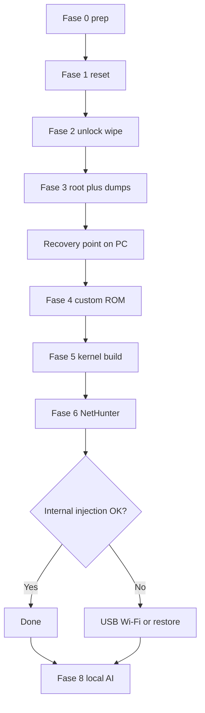

# Plan (condensed): Kali NetHunter on Realme GT 2 (RMX3311 / porsche)

Full checklists live under [phases/](phases/). This file mirrors the phase structure from the master plan.

**Execution tracker:** [STATUS.md](STATUS.md) (what is done on PC vs phone). Scripts for Phase 5 exist in the repo as **scaffolding**; do not treat them as permission to skip Phases 0–4 on the device.

## Hardware & viability

- **RMX3311 EU**, codename **porsche**, **SM8350** (Snapdragon 888), Android kernel **5.4**.
- Wi-Fi: **WCN6856**, driver **qcacld-3.0** — monitor mode is documented; **frame injection is experimental** (2026.x Kali work).
- Custom ROM kernels use the **OnePlus 9 / sm8350** tree; OP9 already has NetHunter injection kernels — realistic port base.
- **No** official `devices.yml` entry for porsche — **port required**.

## Critical warnings

- Deep Testing / unlock **inconsistent on EU RMX3311** — stop if unlock fails.
- **Never** flash **CN/IN** firmware on **RMX3311**.
- Recovery is **partition dumps + stock boot images + Full OTA EU**, not Nandroid (no stable TWRP on A14/A15).
- Assume **brick risk**.

## Work environment

- **WSL2** (Ubuntu 22.04+ or Kali): kernel build, ~40–60 GB free.
- **Windows**: `platform-tools`, Oppo/Realme USB drivers, QDLoader for EDL.
- Rescue: MSM/Oplus tool + **EU OFP** when needed.

## Phase overview

| Phase | Title | Goal |
|-------|--------|------|
| [0](phases/00-prep.md) | Prep | PC tools, WSL, note firmware, download **Full OTA EUEX** |
| [1](phases/01-factory-reset.md) | Factory reset | Clean starting state + personal backup |
| [2](phases/02-bootloader-unlock.md) | Unlock | Deep Testing → `fastboot flashing unlock` |
| [3](phases/03-recovery-point.md) | Recovery point | Magisk root + **dd** critical partitions + stock boot dumps |
| [4](phases/04-custom-rom.md) | Custom ROM | PixelOS 16 or LineageOS 23, verify IMEI/SIM, re-root |
| [5](phases/05-build-kernel.md) | Build kernel | sm8350 + builder + HID/OTG → injection → Docker → AnyKernel zip |
| [6](phases/06-install-test.md) | Install & test | NetHunter Magisk module + kernel; HID/OTG → Wi-Fi inject → Docker |
| [7](phases/07-fallback.md) | Fallback | USB Wi-Fi adapter **or** restore from recovery point |
| [8](phases/08-ai-local.md) | Local AI | `llama.cpp` CPU first; GPU/NPU experimental |

## Recovery-point logic

Factory reset (Phase 1) comes first for a clean phone, but **strong recovery** needs **root** (Phase 3). Unlock (Phase 2) wipes again. Before any flash: have **matching Full OTA EU** on disk.

## Stop conditions

- Phase 2: unlock impossible → **stop** (no custom NetHunter kernel path).
- Phase 6: internal injection fails → Phase 7 (adapter or stock restore); project still usable with HID/OTG/chroot.

## Phase detail (one line each)

**0** — Firmware version, Full OTA EU, platform-tools, drivers, WSL deps, battery > 60%.

**1** — Backup personal data; factory reset.

**2** — OEM unlock + USB debugging; new Deep Testing APK; wait approval; `fastboot flashing unlock`.

**3** — Magisk on stock EU boot; backup `persist`, `modemst1`, `modemst2`, `fsg`, `fsc`, `oplusreserve`; keep stock `boot`/`vendor_boot`/`dtbo` from OTA.

**4** — Flash PixelOS/Lineage; fix IMEI with EU `modem.img` if needed; Magisk again.

**5** — Clone sm8350 kernel + porsche DTS; Sakura OP9 Pro reference; kernel-builder; HID/OTG then qcacld injection; Docker `check-config.sh`; AnyKernel zip for `porsche`.

**6** — NetHunter Magisk install + kernel flash; test HID/OTG/chroot; then `wlan0` injection; Docker hello-world + networked container.

**7** — OTG external Wi-Fi **or** flash stock boot + restore partitions / Full OTA / EDL OFP EU.

**8** — `llama.cpp` on CPU (Termux/chroot/Docker); OpenCL/Vulkan/Hexagon v68 as optional experiments.

See individual phase files for checklists.

**Execution gates:** [STATUS.md](STATUS.md) · [PHASE-GATES.md](PHASE-GATES.md)
